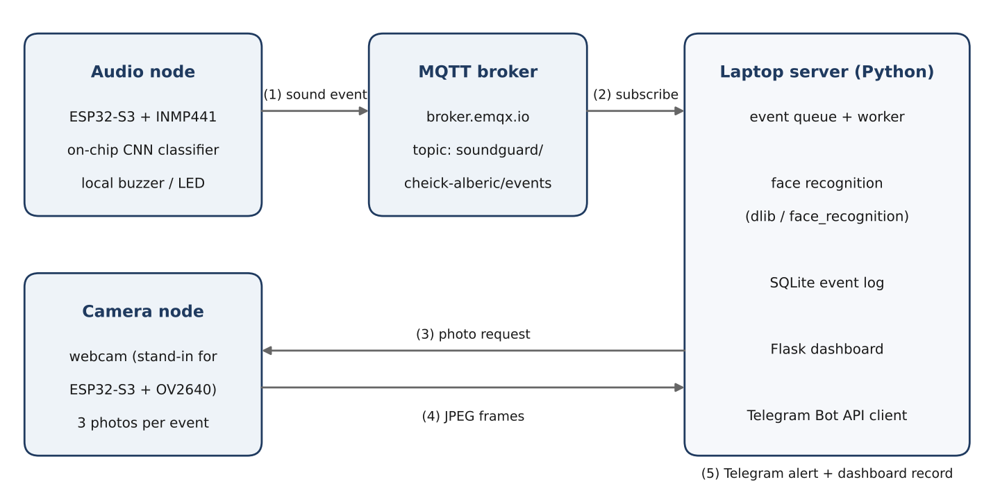
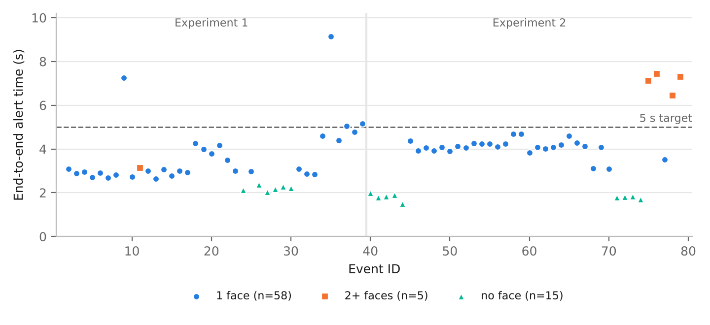

# SoundGuard: AI Sound-Triggered Security Camera

IoT project: a dangerous sound (gunshot or scream) detected on an ESP32-S3 audio node triggers photographs, face recognition and an instant Telegram alert. This repository contains the server side, the dataset preparation script and the measured results.

**Authors:** Zielieba Alberic Queneth Hien, Cheick Ould Nema

## How it works

1. The audio node classifies 1-second audio windows (gunshot / scream / background) and publishes an event over MQTT:
   `{"class": "scream", "confidence": 0.91, "timestamp": 1795604274.07}`
2. The server receives the event, takes 3 photos, and recognises enrolled faces (others are labelled "Unknown").
3. The server sends a Telegram alert with the annotated photo, stores the event in SQLite and shows it on a web dashboard.



## Repository contents

| Folder | Contents |
|---|---|
| `server/` | `server.py` (MQTT, face recognition, Telegram, dashboard), `enroll_face.py`, `fake_event.py` (event simulator), `check_mqtt.py`, `get_chat_id.py`, `config.py` |
| `dataset_preparation/` | `prepare_dataset.py`: builds the 3-class sound dataset (16 kHz mono) for Edge Impulse |
| `results/` | `soundguard_events.csv` (79 recorded events) and `SoundGuard_Results.xlsx` (latency and face recognition analysis) |
| `docs/` | Figures |

## Run the server (Windows / Python 3.10)

```
pip install -r requirements.txt
```
On Windows, if `face_recognition` fails to build dlib, install a pre-built version:
```
pip install dlib-bin
pip install face_recognition --no-deps
pip install face_recognition_models click
```
Then, inside `server/`:
1. Put your Telegram bot token in `config.py`, send a message to your bot, and run `python get_chat_id.py` to get the chat ID.
2. Run `python check_mqtt.py` to find an MQTT broker reachable from your network and copy the suggested settings into `config.py`.
3. Enrol a consenting person: `python enroll_face.py <Name>` (SPACE = photo, Q = quit).
4. Start the server: `python server.py`, then open http://localhost:5000
5. In a second terminal, simulate sound events: `python fake_event.py scream`, or `python fake_event.py test 20` for a latency test.

## Dataset preparation

Download into one folder (`data/`): UrbanSound8K, ESC-50 and the Kaggle Human Screaming Detection Dataset. Then run `python prepare_dataset.py`. Result used in the paper: gunshot 374, scream 499, background 581 clips.

- UrbanSound8K: https://urbansounddataset.weebly.com/urbansound8k.html
- ESC-50: https://github.com/karolpiczak/ESC-50
- Human Screaming Detection Dataset: https://www.kaggle.com/datasets/whats2000/human-screaming-detection-dataset

## Results (78 events after optimisation)

- Median end-to-end alert time: 3.66 s; 89.7% of alerts within 5 s
- Face recognition with two enrolled users: 82.5% of events labelled exactly, no identity confusion



## Privacy

Enrolment photos, event photos and the database stay on the local machine and are excluded from this repository (`.gitignore`). Face data were collected only from the two authors, with consent (KVKK, Law No. 6698).
